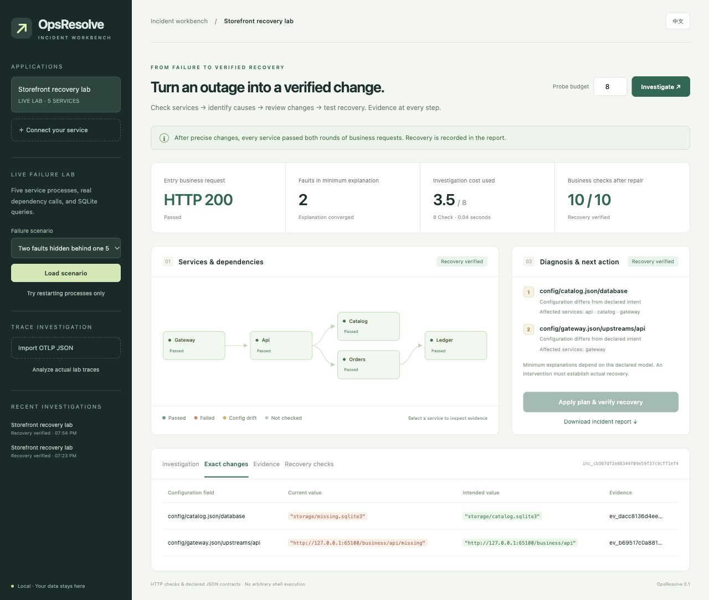

# OpsResolve

Version **0.2.0 (prerelease)** is distributed through [GitHub Releases](https://github.com/crown-sports/opsresolve/releases/tag/v0.2.0) as a wheel, source archive, and `SHA256SUMS`. Installation below pins this version; no PyPI release is required.

**Turn an HTTP outage into a precise change and a tested recovery.**

[简体中文](README.zh-CN.md) · [Setup](docs/usage.md) · [Algorithms](docs/algorithms.md) · [Experiments](docs/results.md)

OpsResolve is a local incident workbench for application owners. Give it service
endpoints and dependency/configuration contracts, or import an existing OTLP JSON
trace export. It investigates observed failures, retains alternative explanations,
shows exact configuration changes, and tests business requests after a repair.



## The problem it solves

A storefront returns 503. Its liveness endpoint is green. Restarting its services
leaves a wrong upstream URL in place. Correcting that URL reveals a second error:
the catalog reads an incorrect SQLite database path.

OpsResolve checks the application and its dependencies, identifies both persisted
settings, proposes two field changes, and runs every business check twice. If
recovery fails, it restores the original configuration bytes. A process outage or
unknown application bug instead receives an operator action; it does not invent
an executable repair.

## Is this the right tool?

Use it when you own an HTTP application and need a reviewable incident report
or a before/after trace decision. Start with the input you already have:

| Your immediate question | Start here | Decision or artifact |
| --- | --- | --- |
| “What does a verified repair look like?” | Bundled recovery demo below | Two exact changes and ten recovery checks in `recovery.md` |
| “Did this change worsen recorded traffic?” | `trace-compare` with two exports | Operation-level deltas and a gate that also rejects incomplete coverage |
| “Why is my endpoint failing?” | URL triage, then a target manifest | Observations and candidate explanations; repair only where you declared a supported contract |

Manual HTTP checks and configuration edits can solve the same incident. This
workbench keeps their evidence, patch preconditions and recovery checks together.
Keep your existing monitoring and tracing system for collection and alerts;
OpsResolve consumes declared targets or exported records. It is not a hosted
observability backend. [Implementation evidence and priorities](docs/product.md).

## Try a complete recovery

Python 3.11+ on Linux or macOS. No API key, Docker cluster, or GPU is needed.

```bash
git clone --branch v0.2.0 https://github.com/crown-sports/opsresolve.git
cd opsresolve
python3 -m venv .venv
source .venv/bin/activate
python -m pip install -e '.[web]'
opsresolve serve --demo
```

Open **http://127.0.0.1:8765**. Select **Investigate**, review **Exact changes**,
then select **Apply plan & verify recovery**. The lab runs five real HTTP processes
and real SQLite queries. The default scenario contains two masked configuration
faults. The UI supports English and Chinese.

For a terminal demonstration:

```bash
opsresolve demo --report recovery.md
```

**Success:** the terminal ends with `Recovery: verified (10 business checks)`;
`recovery.md` contains the two configuration changes and their recovery evidence.
The incident is preserved in `~/.opsresolve`.
The disposable application processes are stopped when the command exits.

## Use it on your application

| Input | What you receive | Setup |
|---|---|---|
| One HTTP URL | Actual status/transport evidence and endpoint-level triage | “Connect your service” in the UI |
| Target manifest | Dependency diagnosis, alternative fault sets, selected checks, a report | `opsresolve serve --target target.json` |
| Manifest + repair-enabled JSON contracts | Reviewable field changes, stale-plan checks, tested recovery or rollback | Explicit `--allow-repair` for real targets |
| OTLP JSON / collector JSON-lines export | Recorded error-origin candidates, propagation, service edges, exclusive span time | Import in UI or `opsresolve trace export.json` |
| Two comparable OTLP exports | Per-operation regressions, coverage gaps and a CI exit status | `opsresolve trace-compare before.json after.json --check` |

```bash
opsresolve init --url http://127.0.0.1:3000/ --output target.json
opsresolve diagnose target.json --report incident.md
opsresolve trace traces.json --output trace-report.md
```

A URL alone cannot reveal arbitrary dependencies or hidden configuration. The
[setup guide](docs/usage.md) explains the manifest and shows how to declare actual
business checks. Automatic repair currently supports nonsensitive existing JSON
fields in applications that reload them without a restart. YAML, environment
files, arbitrary code patches, SSH commands, and Kubernetes mutations are outside
this release.

For a first real trial, use an exported trace file or a development service with
a business URL you can safely probe. Check that names, dependencies and expected
responses describe that application before adding repair contracts. The local
demo proves the workflow on its fixtures; it does not validate your manifest.

## Compare a change against recorded traffic

```bash
opsresolve trace-compare examples/trace-regression/before.json examples/trace-regression/after.json --check
opsresolve trace-compare before.json after.json --format json --output comparison.json
```

Match **service + operation**, inspect error-rate and p95 deltas, and see added,
missing or undersampled operations. Defaults require at least 5 spans in each
export; latency must increase by both 20% and 10 ms, while any error-rate increase
is flagged. Override with `--min-spans`, `--latency-increase-pct`,
`--latency-increase-ms`, and `--error-increase-pp` (percentage points).
`--check` exits 1 for regressions **or incomplete coverage**, 0 for no observed
regression, and 2 for invalid input. The bundled synthetic example deliberately
fails the gate. Compare like-for-like sampling and workloads: these are observed
samples, not a significance test or proof that a deployment caused the change.

## Useful mechanisms

- **Bounded multi-fault diagnosis:** dependency failure propagation plus exact
  configuration observations, with subset-minimal consistent explanations.
  Unknown checks remain unknown; conflicting observations produce a model conflict.
- **Active investigation:** select the next check by predicted information per
  declared cost, retaining simultaneous faults during selection. A fixed
  configuration-first strategy is included for comparison.
- **Intervention verification:** only observed, enabled configuration contracts
  produce patches. Whole-file hashes, exact field preconditions, a workspace lock,
  ownership/mode preservation, backups, and all-service recovery checks bound writes.
  Interrupted transactions have a reviewable recovery ledger.
- **Trace investigation:** find deepest recorded failed operations rather than
  counting every propagated 503 as an independent origin. Overlapping child
  intervals are counted once when computing exclusive span duration.
- **Optional local AI explanation:** Ollama or local Hugging Face inference writes
  an explanation after diagnosis. Fault identifiers and exact source references
  are checked before display. The model cannot choose mutations or execute commands.

These use established diagnostic and information-theoretic ideas. The contribution
is their integration into a runnable, inspectable recovery workflow; this is not
a claim of a new causal learning algorithm or of superior general-agent capability.

## Evidence and limitations

Published results include exact source fingerprints, raw observations, plans,
before/after HTTP results, unsuccessful comparisons, and model-report rejections.
See [experiments](docs/results.md) for measured numbers and reproduction commands.
Development fixtures cover three service graphs and known fault families. They
are not production incidents, an external RCA benchmark, or evidence of universal
diagnostic accuracy.

The model assumes required dependencies in a DAG and a configured fault-count
bound. Optional dependencies, intermittent failures, missing instrumentation, and
unmodeled resource faults can leave ambiguity or conflict. Model weights are not
calibrated incident probabilities. Passing declared checks establishes recovery
of those checks, not the absence of every possible fault.

The browser binds to loopback for one trusted local operator. Use an SSH tunnel
for a remote machine; do not expose it as a multi-user production service.
Configuration directories must be trusted and external writers should coordinate
with the workspace lock. File replacements are atomic individually; a multi-file
intervention is restored on failure, not globally atomic to concurrent readers.

## Develop

```bash
python -m pip install -e '.[web,dev]'
ruff check src tests benchmarks
ruff format --check src tests benchmarks
mypy src
pytest -q
python -m build
```

The small core uses the standard library. HTTP/UI and model dependencies are
optional extras. [Design](docs/design.md), [related work](docs/related-work.md), and
[contribution guidance](CONTRIBUTING.md) describe the boundaries and extension
points. MIT licensed.
