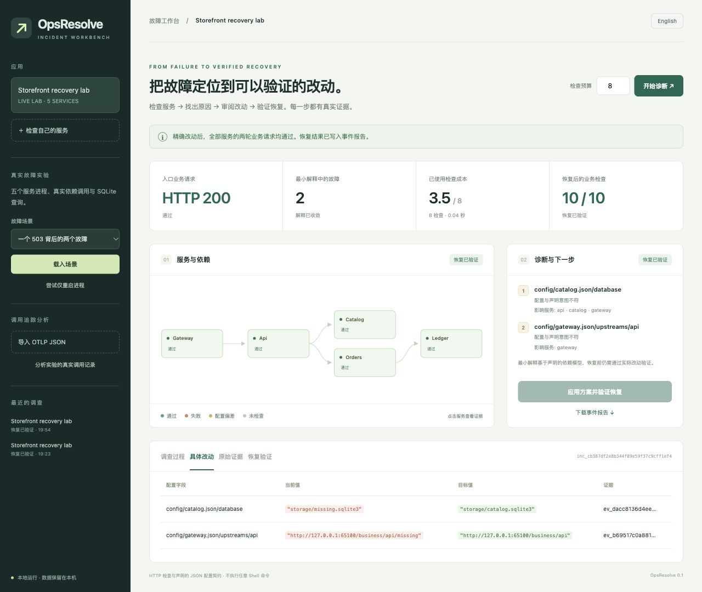

# OpsResolve

当前版本 **0.2.0（预发布）**，通过 [GitHub Releases](https://github.com/crown-sports/opsresolve/releases/tag/v0.2.0) 提供 wheel、源码归档和 `SHA256SUMS`；不依赖 PyPI 发布。安装说明固定到此版本。

**网站或 API 出故障后，找出具体原因、改动具体配置，并确认业务真的恢复。**

[English](README.md) · [接入方法](docs/usage.md) · [算法说明](docs/algorithms.md) · [实测记录](docs/results.md)

这是一个可以直接操作的本地故障工作台。输入服务地址、服务依赖与配置契约，
或者导入已有的 OpenTelemetry 调用追踪；输出实际检查结果、故障解释、具体改动
和修复后的业务验证结果。



## 解决什么问题

例如：一个商城接口返回 503，但各进程的存活检查都正常。重启没有用，因为网关
保存了错误的上游地址。修好地址以后，才发现目录服务还指向一个错误的数据库路径。

工作台会继续检查被第一个故障掩盖的第二个故障，提出两个具体字段的修改，
再对五个服务各执行两轮业务请求。全部通过才显示“恢复已验证”；失败则恢复修改前的
配置。如果定位到进程不可用或未覆盖的应用错误，它会列出需要人工处理的项目。

## 先完整体验一次

需要 Linux 或 macOS、Python 3.11 以上。首次体验不需要模型 API Key、GPU 或 Kubernetes。

```bash
git clone --branch v0.2.0 https://github.com/crown-sports/opsresolve.git
cd opsresolve
python3 -m venv .venv
source .venv/bin/activate
python -m pip install -e '.[web]'
opsresolve serve --demo
```

打开 **http://127.0.0.1:8765**，依次操作：

1. 点击“开始诊断”，查看真实检查与两处配置错误。
2. 点击“具体改动”，审阅修改前后的值。
3. 点击“应用方案并验证恢复”，查看十次业务请求的结果。
4. 下载事件报告，保留检查、证据、改动和验证记录。

实验由五个真实 HTTP 进程和 SQLite 查询构成。也可以运行
`opsresolve demo --report recovery.md`，在终端完成同一条恢复流程。

## 输入和输出

| 输入 | 输出 | 如何使用 |
|---|---|---|
| 一个服务 URL | HTTP 状态、连接失败阶段与端点级排查 | 网页“检查自己的服务” |
| 服务依赖清单 | 跨服务故障解释、备选原因、检查过程与事件报告 | `opsresolve serve --target target.json` |
| 依赖清单与允许修复的 JSON 配置字段 | 精确修改、过期方案拒绝、恢复验证或回滚 | 真实目标需显式启用 `--allow-repair` |
| OTLP JSON 或 Collector JSON-lines 追踪文件 | 已记录的错误起点候选、错误传播、服务调用关系和独占耗时 | 网页导入或 `opsresolve trace export.json` |

单个 URL 无法凭空发现整个应用架构；需要进一步定位时，添加依赖与配置契约。
配置修复目前覆盖可热加载的、非敏感的已有 JSON 字段；YAML、环境变量文件、任意源码
修改、Shell 命令和 Kubernetes 变更还未实现。

## 算法与工程价值

根据依赖关系推演有限的单故障和多故障组合，再用实际观测排除不一致的组合。
选择检查时保留多故障可能性，按预计信息量与声明成本挑选下一步；证据不足就保留备选
解释，模型与事实冲突就明确报告冲突。模型权重不是经过生产标定的故障概率。

修复方案来自直接观察到的配置偏差，受文件散列、字段前提、目录范围与声明契约约束。
执行时保留所有权和权限、记录备份与事务账本，再检查全部服务两轮；失败回滚，
进程中断后可通过 `opsresolve recover target.json` 审阅待恢复的写入。

追踪分析把深层失败调用与向上游传播的错误分开；并用子调用区间的并集扣除重叠耗时，
避免把并行调用重复计算。它给出历史记录中的候选起点，仍需要检查或干预验证。

可选本地模型负责把调查结果解释给人，输出的故障编号与原文引用会被校验。
诊断、检查选择、配置改动和恢复验证由程序控制，首次使用不依赖模型。

这些算法思想已有研究基础。项目的贡献是把它们整合成可运行、可审阅、可验证的工作流，
不宣称首创因果学习算法，也不声称其他 Agent 项目无法实现同类功能。

## 效果以实测为准

[实测记录](docs/results.md)公开完整分母、源码指纹、原始检查、改动、恢复请求以及
模型解释被拒绝的记录。实验使用我们自己的进程故障夹具，涵盖三个服务拓扑；
它不能代表生产环境或外部根因分析评测的通用准确率。

第一版面向一个可信的本地操作者，浏览器服务只绑定回环地址。远程使用通过 SSH 隧道
连接。依赖模型假设清单中的依赖是业务请求必需的，且图中没有环；可选依赖、间歇故障
及未覆盖的故障类型可能留下歧义。每个文件独立原子替换，多文件修复不是对并发读者
全局原子的事务。通过声明的业务检查，代表这些检查恢复，不代表系统不存在任何故障。

更多信息：[接入指南](docs/usage.md)、[设计计划](docs/design.md)、[相关项目与研究](docs/related-work.md)。
使用 MIT 许可证；核心没有运行时第三方依赖，网页与模型能力按需安装。
